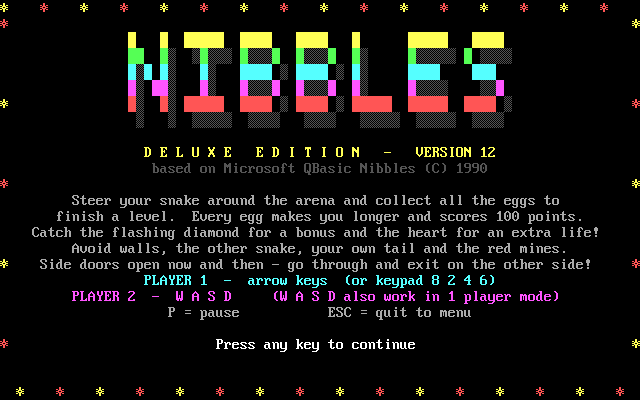
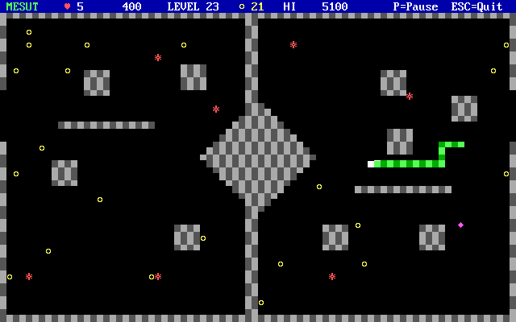

# Nibbles Deluxe

[](https://en.wikipedia.org/wiki/QBasic)
[](https://www.dosbox.com/)
[](https://github.com/mesutakcan/Nibbles-Deluxe/stargazers)
[](https://github.com/mesutakcan/Nibbles-Deluxe/forks)
[](https://github.com/mesutakcan/Nibbles-Deluxe/issues)
[](https://github.com/mesutakcan/Nibbles-Deluxe/releases)

An improved version of the classic **Microsoft QBasic Nibbles** (1990), written in
**QuickBASIC 4.5**. One or two players steer snakes around an arena, eat the numbers in
order and try to stay alive.



The game is published version by version; every version has its own release. The BASIC file is
always called `NIBBLESD.BAS` and the program `NIBBLESD.EXE`.

## Features

- Direct video memory graphics: fast, flicker free, exact colours
- Settings menu: players, speed, colour theme, start level, sound
- Three colour themes: Classic, Night, Mono
- Animated title screen with a big logo
- Bright snake heads; the snakes are visible before a round starts
- Turn buffer: fast key presses are never lost, and a snake can no longer reverse into itself
- Flashing bonus diamonds and a bonus for completing a level
- Lives that really count down, game over screen with the winner
- The high score is saved to `NIBBLES.HI`
- The game speed is calibrated at start-up, so it plays the same on any computer
- 12 levels (the 10 original levels plus 2 new ones)



## Download

Go to the [Releases](https://github.com/mesutakcan/Nibbles-Deluxe/releases) page and
download the stand-alone `NIBBLESD.EXE`. It runs in DOS or in DOSBox without anything else.

The BASIC source is in the [`src`](src) folder.

## Requirements

- A VGA colour display (DOS, or an emulator such as DOSBox)
- To run the source: QuickBASIC 4.5 (QB45)

The game was developed and tested with QuickBASIC 4.5 in DOSBox. The source is written to run
in QBasic 1.1 as well.

## How to run

**The EXE file**

1. Copy `NIBBLESD.EXE` to a folder.
2. Start it in DOS, or in DOSBox:

   ```
   mount c C:\games\nibbles
   c:
   NIBBLESD
   ```

**The source in QB45**

1. Copy `src/NIBBLESD.BAS` to your QB45 folder.
2. Start QB45, open the file and press **F5**, or run `QB NIBBLESD.BAS /RUN`.

## Controls

| Key | Action |
| --- | --- |
| Arrow keys (or keypad 8 2 4 6) | Player 1 steers |
| W A S D | Player 2 steers (in one player mode they steer player 1, too) |
| P | Pause |
| ESC | Quit to the menu (asks Yes / No) |
| SPACE or ENTER | Close a message box |

Menus: UP / DOWN select a line, LEFT / RIGHT (or SPACE) change a setting, ENTER starts the
game, ESC quits. On the game over screen ENTER plays again, M returns to the menu and ESC
quits.

## How to play

Steer your snake and eat the numbers **1 to 9 in order**. When you have eaten the 9, the
level is complete. You lose a life if your snake hits a wall, the other snake or its own
tail. If both heads meet, both snakes die.

- **Number n**: n x 100 points, and your snake grows by n x 4 pixels.
- **Flashing diamond**: 500 points. It shows up now and then after you eat a number and
  disappears after a few seconds.
- **Level complete**: 500 bonus points.
- **Lives**: 5 for every player. The game is over when a player has no life left. With two
  players the higher score wins.
- **Speed**: gets about 7 percent faster with every level (can be switched off).

If a snake crashes, the level starts again with the same walls.

## Levels

12 levels with different walls. Levels 1 to 10 are the original Nibbles levels; level 11 is a
box with four gates and level 12 is a big plus sign. After level 12 the levels start again
(and, with "Faster each level" switched on, the game keeps getting faster).

## Settings

| Setting | Values |
| --- | --- |
| Players | 1 or 2 |
| Speed | 1 to 10 |
| Faster each level | ON / OFF |
| Start level | 1 to 12 |
| Colors | CLASSIC, NIGHT, MONO |
| Sound | ON / OFF |

The players are called SAMMY and JAKE.

## Files the game creates

| File | Content |
| --- | --- |
| `NIBBLES.HI` | The high score |

The file is written to the current directory and keeps this name in every version, whatever
the program file is called. Delete it to reset the high score.

## Building the EXE

In QB45: open `NIBBLESD.BAS`, choose **Run > Make EXE File**, select **Stand-Alone EXE File**
and press **Make EXE**.

From the command line (QB45 tools):

```
BC /O NIBBLESD.BAS;
LINK NIBBLESD.OBJ,,,BCOM45.LIB;
```

## History

Newest version first.

### Version 2 - 2026-10-08

- Direct video memory graphics for fast, flicker-free drawing with exact colours
- Settings menu for players, speed, colour theme, start level and sound
- Three colour themes: Classic, Night and Mono
- Animated title screen with a large logo
- Bright snake heads, visible before a round starts
- Buffered turns so quick key presses are not lost and snakes cannot reverse into themselves
- Flashing bonus diamonds and a level-complete bonus
- Lives count down correctly; the game-over screen shows the winner
- High score saved to `NIBBLES.HI`
- Game speed calibrated to play consistently on different computers
- Two extra levels, for 12 levels in total

## Credits

Based on **Microsoft QBasic Nibbles**, Copyright (C) Microsoft Corporation 1990. This version
changes and extends the original game; the original levels 1 to 10 and the basic idea of the
game come from it.
