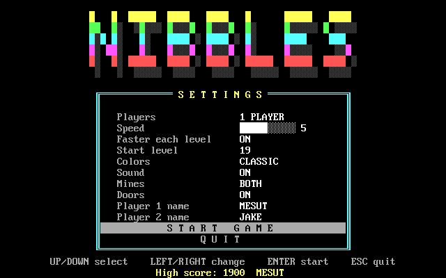
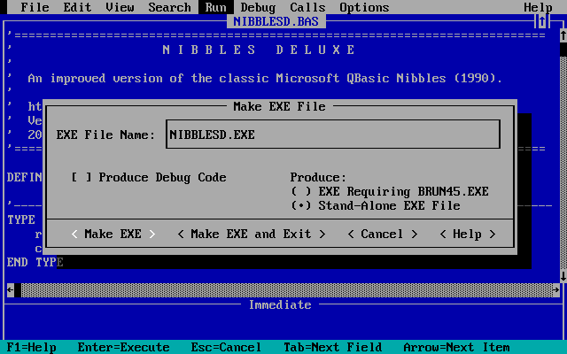

# Nibbles Deluxe

[](https://en.wikipedia.org/wiki/QuickBASIC)
[](https://www.dosbox.com/)
[](https://github.com/mesutakcan/Nibbles-Deluxe/stargazers)
[](https://github.com/mesutakcan/Nibbles-Deluxe/forks)
[](https://github.com/mesutakcan/Nibbles-Deluxe/issues)
[](https://github.com/mesutakcan/Nibbles-Deluxe/releases)

An improved version of the classic **Microsoft QBasic Nibbles** (1990), written in
**QuickBASIC 4.5**. One or two players steer snakes around an arena, collect all the eggs
and try to stay alive.

The game runs in DOS / DOSBox (QuickBASIC 4.5 or QBasic 1.1), and also natively on
**Windows** (32 bit and 64 bit), compiled with
[QB64 Phoenix Edition](https://github.com/QB64-Phoenix-Edition/QB64pe).


The game is published version by version; every version has its own release. The BASIC file is
always called `NIBBLESD.BAS`.

## Features

- Direct video memory graphics: fast, flicker free, exact colours
- Settings menu: players, speed, colour theme, start level, sound, mines, doors, player names
- Three colour themes: Classic, Night, Mono
- Animated title screen with a big logo
- Eggs to collect on every level (8 + level number, at most 25)
- A heart appears when only one egg is left: catch it for an extra life
- Bright snake heads; the snakes are visible before a round starts
- Two-tone striped snake bodies
- Red mines: random mines pop up during play, fixed mines are placed when a level starts
  (the game checks that every egg stays reachable); mode OFF / RANDOM / FIXED / BOTH
- Three death animations, chosen at random
- The egg counter in the status line blinks when only 1 or 2 eggs are left
- Side doors: now and then the walls open on both sides; go through one and come out on the other side
- Turn buffer: fast key presses are never lost, and a snake can no longer reverse into itself
- Flashing bonus diamonds and a bonus for completing a level
- Lives that really count down (the heart in the status line blinks on the last life),
  game over screen with the winner
- Player names can be changed in the menu
- Settings and names are saved to `NIBBLES.CFG`; the high score and the name of its owner
  are saved to `NIBBLES.HI`
- The game speed is calibrated at start-up, so it plays the same on any computer
- 20 levels (the 10 original levels plus 10 new ones)
- Runs in DOS / DOSBox and natively on Windows (32 bit and 64 bit)


## Download

Go to the [Releases](https://github.com/mesutakcan/Nibbles-Deluxe/releases) page. Each
release offers these stand-alone programs:

| File | For |
| --- | --- |
| `NIBBLESD.EXE` | DOS or DOSBox (compiled with QuickBASIC 4.5) |
| `Nibbles-Deluxe-x64.exe` | Windows, 64 bit (compiled with QB64-PE) |
| `Nibbles-Deluxe-x86.exe` | Windows, 32 bit (compiled with QB64-PE) |

No emulator is needed for the two Windows files: download one and double-click it. On a
64 bit Windows (for example Windows 11) use the x64 file; the x86 file is for 32 bit
systems. Windows may show a SmartScreen warning for a program that is downloaded from the
internet and is not signed; the source code of the game is in the [`src`](src) folder, and you
can compile it yourself (see below).

The BASIC source is in the [`src`](src) folder.

## Requirements

- **Windows version:** Windows with the x86 or x64 file; nothing else is needed.
- **DOS version:** a VGA colour display (DOS, or an emulator such as DOSBox).
- **To run the source:** QuickBASIC 4.5 (QB45), QBasic 1.1, or QB64-PE

The game was developed and tested with QuickBASIC 4.5 in DOSBox. The source has also been tested and runs in QBasic 1.1 and QB64-PE. The Windows builds are compiled with QB64-PE on Windows 11 and run there without an emulator.

## How to run

**The Windows EXE (QB64-PE build)**

1. Download `Nibbles-Deluxe-x64.exe` (or `Nibbles-Deluxe-x86.exe`) from the Releases page.
2. Copy it to a folder where you may write files, and start it.

The game saves `NIBBLES.CFG` and `NIBBLES.HI` in the current directory, so do not run it from
a folder that is write-protected.

**The DOS EXE**

1. Copy `NIBBLESD.EXE` to a folder.
2. Start it in DOS, or in DOSBox:

   ```
   mount c C:\games\nibbles
   c:
   NIBBLESD
   ```

**The source in QB45**

1. Copy `src/NIBBLESD.BAS` to your QB45 folder.
2. Start QB45, open the file and press **F5**, or run `QB NIBBLESD.BAS /RUN`.

## Controls

| Key | Action |
| --- | --- |
| Arrow keys (or keypad 8 2 4 6) | Player 1 steers |
| W A S D | Player 2 steers (in one player mode they steer player 1, too) |
| P | Pause |
| ESC | Quit to the menu (asks Yes / No) |
| SPACE or ENTER | Close a message box |

Menus: UP / DOWN select a line, LEFT / RIGHT (or SPACE) change a setting, ENTER starts the
game (on the two name lines ENTER lets you type a name), ESC quits. On the game over screen
ENTER plays again, M returns to the menu and ESC quits.

## How to play

Steer your snake and collect **all the eggs** of the level. The number of eggs is shown in
the status line and grows with the level: 8 + the level number, at most 25. You lose a life
if your snake hits a wall, the other snake, its own tail or a mine. If both heads meet, both
snakes die.

- **Egg**: 100 points, and your snake grows by 3 pixels.
- **Flashing diamond**: 500 points. It shows up now and then after you eat an egg and
  disappears after a few seconds.
- **Heart**: appears when only one egg is left, on the reachable spot that is farthest from
  the snakes. It flashes faster and faster; catch it in time for one extra life (at most 9
  lives). There is one heart per level. If you take the last egg first, the level ends and
  the heart is lost.
- **Level complete**: 500 bonus points.
- **Lives**: 5 for every player. The heart in the status line blinks when only one life is
  left. The game is over when a player has no life left. With two players the higher score
  wins.
- **Speed**: gets about 7 percent faster with every level (can be switched off).

**Side doors** open now and then in the left and right walls (a gap four text rows high). They
blink twice as a warning, open and stay open for about 10 seconds, then blink again and close.
A snake that enters an open door leaves the arena on the other side, like in Pac-Man. The doors
never open in front of walls, snakes, eggs or mines, and they wait to close while a snake is
still inside the gap. They can be switched off with the **Doors** setting.

If a snake crashes, the level starts again with the same walls. Red mines may appear
randomly after an egg is eaten. There can be up to three mines on screen at once, never
close to a snake head; each flashes and disappears after about 12 seconds. Hitting one costs
a life.

**Fixed mines** are placed when a level starts (from level 2: level number / 2, at most 6;
with two players they come in point symmetric pairs, so neither side has an advantage) and
stay until the level ends. A path search makes sure that every egg can still be reached.
Which kinds of mines appear is set with the **Mines** setting (default BOTH).

When a snake dies, one of three death animations is played (the two body shades blink away
in turn, the snake is wiped out from head to tail, or both one after the other).

## Levels

20 levels with different walls. Levels 1 to 10 are the original Nibbles levels. The new levels
are:

| Level | Walls |
| --- | --- |
| 11 | A box with four gates |
| 12 | A big plus sign |
| 13 | Bunkers: four corner pockets |
| 14 | Pinwheel |
| 15 | Diamond |
| 16 | Pillars |
| 17 | Serpentine |
| 18 | Crossed diagonals |
| 19 | Fortress |
| 20 | Nested boxes |

After level 20 the levels start again (and, with "Faster each level" switched on, the game
keeps getting faster).

## Settings

| Setting | Values |
| --- | --- |
| Players | 1 or 2 |
| Speed | 1 to 10 |
| Faster each level | ON / OFF |
| Start level | 1 to 20 |
| Colors | CLASSIC, NIGHT, MONO |
| Sound | ON / OFF |
| Mines | OFF, RANDOM, FIXED, BOTH |
| Doors | ON / OFF |
| Player 1 name | up to 8 characters (default SAMMY) |
| Player 2 name | up to 8 characters (default JAKE) |

The settings and the names are saved when you leave the menu and are loaded the next time
the game starts.



## Files the game creates

| File | Content |
| --- | --- |
| `NIBBLES.CFG` | The player names and all menu settings (including Doors) |
| `NIBBLES.HI` | The high score and the name of its owner |

Both files are written to the current directory and keep these names in every version,
whatever the program file is called. Delete them to start fresh. A `NIBBLES.HI` file from
version 3 or earlier (score only) can still be read.

## Building the EXE

You can build the game yourself in two ways: with QuickBASIC 4.5 for DOS, or with QB64-PE
for Windows.

### DOS EXE with QuickBASIC 4.5

In QB45: open `NIBBLESD.BAS`, choose **Run > Make EXE File**, select **Stand-Alone EXE File**
and press **Make EXE**.



From the command line (QB45 tools). The program uses `ON ERROR ... RESUME NEXT` for the
file access, so it has to be compiled with `/E` and `/X`:

```
BC NIBBLESD.BAS /E/X/O/T/C:512;
LINK /EX NIBBLESD.OBJ,NIBBLESD.EXE,NUL,BCOM45.LIB;
```

`/E` and `/X` support `ON ERROR` and `RESUME`, `/O` makes a stand-alone program, `/T`
suppresses warning messages, `/C:512` sets the communications buffer size, and `LINK /EX`
packs the EXE file. Run both commands in the folder that holds `NIBBLESD.BAS` and
`BCOM45.LIB` (or give full paths).

In DOSBox you can start the same commands from the
`mount`ed QB45 folder, for example `C:\QB45\BC.EXE C:\QB45\NIBBLES\SRC\NIBBLESD.BAS/E/X/O/T/C:512;`
followed by `C:\QB45\LINK.EXE /EX NIBBLESD.OBJ,NIBBLESD.EXE,NUL,C:\QB45\LIB\BCOM45.LIB;`.

### Windows EXE (32 bit and 64 bit) with QB64-PE

[QB64 Phoenix Edition](https://github.com/QB64-Phoenix-Edition/QB64pe) is a modern compiler
that accepts QuickBASIC code and creates native Windows programs. The source of Nibbles
Deluxe compiles unchanged.

1. Download QB64-PE from its
   [releases page](https://github.com/QB64-Phoenix-Edition/QB64pe/releases) and unpack it to
   a folder, for example `C:\qb64pe`.
2. Open PowerShell and compile the source from the command line. `-c` compiles without
   starting the program, `-f:TargetBits=` selects 32 or 64 bit, `-o` is the output file.
   Change the three paths to your own folders.

   **64 bit:**

   ```powershell
   $QB64 = "C:\qb64pe\qb64pe.exe"
   $SRC  = "C:\nibbles\src\NIBBLESD.BAS"
   $OUT  = "C:\nibbles\Nibbles-Deluxe-x64.exe"
   & $QB64 -c "$SRC" "-f:TargetBits=64" -o "$OUT"
   ```

   **32 bit:**

   ```powershell
   $QB64 = "C:\qb64pe\qb64pe.exe"
   $SRC  = "C:\nibbles\src\NIBBLESD.BAS"
   $OUT  = "C:\nibbles\Nibbles-Deluxe-x86.exe"
   & $QB64 -c "$SRC" "-f:TargetBits=32" -o "$OUT"
   ```

3. Start the new EXE file with a double-click.

Instead of the command line you can also open `NIBBLESD.BAS` in the QB64-PE editor and use
**Run > Make EXE Only**. The command line version is handy for building both files in one go.

## History

Newest version first.

### Version 7 - 2026-10-13

- 8 new levels, for 20 levels in total: bunkers (13), pinwheel (14), diamond (15), pillars
  (16), serpentine (17), crossed diagonals (18), fortress (19) and nested boxes (20)
- The **Start level** setting now goes from 1 to 20
- The levels start again after level 20

### Version 6 - 2026-10-12

- New **side doors**: gaps open in the left and right walls now and then; a snake that goes
  through leaves on the opposite side (warning blink before opening and closing, a door never
  closes on a snake)
- New **Doors** setting (ON / OFF), saved in `NIBBLES.CFG`
- Items and mines are never placed in the door lanes while a door is active
- The intro text explains the doors

### Version 5 - 2026-10-11

- Three death animations (blinking body shades, wipe from head to tail, or both), picked at
  random
- Fixed mines placed at the start of a level (symmetric pairs with two players); a path
  search checks that every egg stays reachable
- New **Mines** setting: OFF, RANDOM, FIXED or BOTH
- The egg counter in the status line blinks when only 1 or 2 eggs are left
- The version number is shown on the title screen

### Version 4 - 2026-10-10

- Eggs replace the numbers 1 to 9: collect all the eggs of a level (8 + level number, at
  most 25); every egg gives 100 points and makes the snake 3 pixels longer
- The status line shows the number of eggs that are left
- A heart appears when one egg is left; catching it gives an extra life (at most 9)
- The heart in the status line blinks when a player has only one life left
- Player names can be edited in the menu
- Menu settings and names are saved to `NIBBLES.CFG`
- The high score file also stores the name of the high score owner

### Version 3 - 2026-10-09

- Added red mines that appear randomly as numbers are eaten; mines can be switched off
- Added alternating two-tone stripes to the snake bodies
- Windows builds (32 bit and 64 bit), compiled with QB64-PE: the game now runs on Windows
  without an emulator; README describes how to build them

### Version 2 - 2026-10-08

- Direct video memory graphics for fast, flicker-free drawing with exact colours
- Settings menu for players, speed, colour theme, start level and sound
- Three colour themes: Classic, Night and Mono
- Animated title screen with a large logo
- Bright snake heads, visible before a round starts
- Buffered turns so quick key presses are not lost and snakes cannot reverse into themselves
- Flashing bonus diamonds and a level-complete bonus
- Lives count down correctly; the game-over screen shows the winner
- High score saved to `NIBBLES.HI`
- Game speed calibrated to play consistently on different computers
- Two extra levels, for 12 levels in total

## Credits

Based on **Microsoft QBasic Nibbles**, Copyright (C) Microsoft Corporation 1990. This version
changes and extends the original game; the original levels 1 to 10 and the basic idea of the
game come from it.

The Windows builds are made with
[QB64 Phoenix Edition](https://github.com/QB64-Phoenix-Edition/QB64pe).
